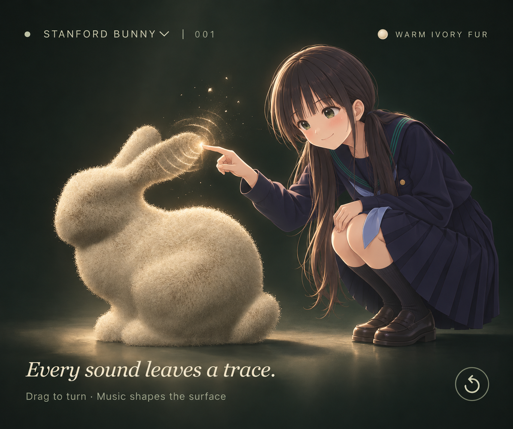
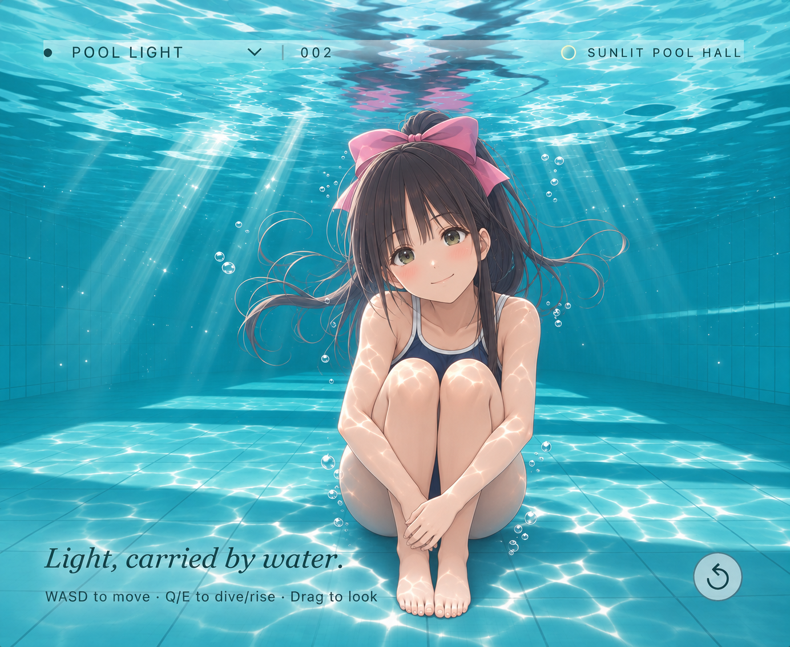
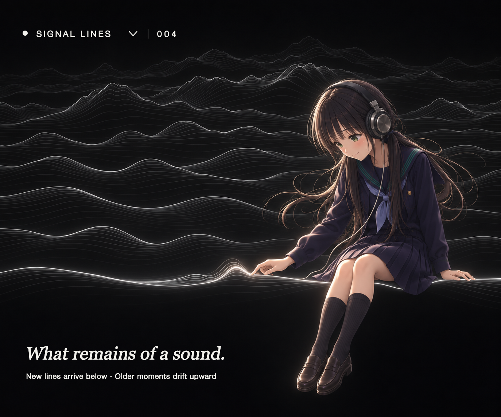
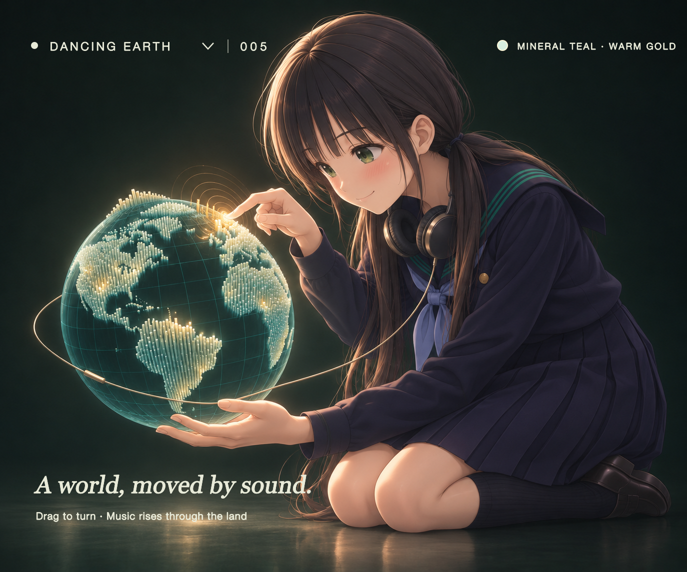

# SoundCanvas — 聴くためのスタジオ

[English](README.md) · [简体中文](README.zh-CN.md) · [日本語](README.ja.md)

5 つのシーンが、一曲の音楽を彫刻、水面、雨の窓、積み重なる輪郭線、光る世界へ変えます。ブラウザーでローカル音声を読み込み、反応を調整し、好きな瞬間に戻って短い映像を書き出せます。アカウント、実行時依存パッケージのインストール、音声のアップロード、ビルドは不要です。

## Stanford Bunny



音楽に反応する Stanford Bunny。暖かなアイボリーの毛並みと銅の表面を切り替えられます。音が形や毛の揺れに作用し、3 つのコントロールで反応を調整できます。

*コンセプトアートです。人物やタッチによる操作はスタジオには実装されていません。*

## Pool Core — Pool Light



陽光が差す白いタイルのプールホール。反射、屈折、水中のコースティクス、水面に浮かぶラバーダックを描画します。プールサイドを歩き、水中に潜り、アヒルを非表示にして水面だけを眺めることもできます。プールコアの雰囲気に着想を得たこのシーンは、スタジオ内では **Pool Light** という名前です。

*シーンの雰囲気を表現したコンセプトアートです。人物や光の表現はリアルタイムレンダラーのスクリーンショットではありません。*

## Rain Window

暗い窓枠で区切られた 4 枚のガラスを近くから眺めるシーンです。水滴は外の景色を屈折させ、合流して流れ、水の跡を残します。雨の状態を保ったまま、手続き的に描いた雨の庭、夕暮れの街、夜の灯りを切り替えられます。音の立ち上がりが新しい滴を促し、持続的なエネルギーと高域成分が雨の密度に作用します。独立した稲光スイッチで、まれな強いアクセントに合わせた窓外の光を有効にできます。

背景は初版の手続き的なイラストで、写真ではありません。水滴数を制限した固定時間ステップのシミュレーションと WebGL の屈折描画を使い、シークと映像出力では該当時刻の状態を再構築します。ガラス上の水の近似表現であり、完全な流体シミュレーションではありません。

## Signal Lines



Joy Division の『Unknown Pleasures』のジャケットに着想を得た、黒地に白い輪郭線を重ねるシーンです。0.18 秒ごとに再生済み音声の輪郭を下に追加し、古い線を滑らかに押し上げます。表示は最大 64 本。局所 RMS 音声プロファイル、中央の包絡、手前の輪郭による遮蔽を使い、元のジャケットのデータや周波数スペクトルを再現するものではありません。

Impact は高さ、Resonance は線の滑らかさ、Growth は中央の起伏の幅を調整します。一時停止でスクロールも止まり、シークと映像出力では同じ音声履歴を再構成します。キャンバスの大きさはほかのシーンと共通です。

*コンセプトアートです。人物やタッチによる操作はスタジオには実装されていません。*

### 安定した細線描画

WebGL のネイティブな 1 ピクセル幅の `LINE_STRIP` は、スクロール中にピクセルグリッドを横切るたびに画素の被覆率が変わり、周期的な明暗の縞を生じさせていました。Signal Lines では各輪郭を細い三角形のリボンとして組み立てます。頂点には中心線からの符号付き距離を持たせ、フラグメントシェーダーがその距離を画素の被覆率へ変換して、端を半透明で滑らかにつなぎます。線幅は物理ピクセル単位で指定し、キャンバスのピクセル密度に合わせて調整するため、通常の画面と高密度画面で近い太さに見えます。新しい輪郭の下には引き続き黒い面を描き、交差した古い輪郭を隠します。

## Dancing Earth



黒に近い鉱物色の青緑の地球を、細い発光柱の列で満たした大陸が覆います。低域は地球全体をわずかに呼吸させ、中域は近接する陸地をまとまりとして動かし、高域は柱の先端を暖かな金色へ変えます。明確な立ち上がりでは、抑えた光の波が大陸を横切ります。

Impact は柱の高さ、Resonance は一緒に動く範囲と減衰、Growth は静止時の柱の密度を調整します。ドラッグまたは矢印キーで回転でき、シークと映像出力では音声時刻と設定から同じ状態を再構築します。陸地サンプルはパブリックドメインの Natural Earth 1:110m データから事前生成します。[データの出典と再生成手順](assets/EARTH-NOTICE.md)を参照してください。科学、標高、政治データではなく、表現のための音と映像の対応付けです。

*コンセプトアートです。人物、ヘッドホン、タッチによる操作はスタジオには実装されていません。*

## ローカルで実行

```sh
npm start
```

[スタジオ](http://127.0.0.1:8080)を開きます。静的サーバーには Python 3 が必要です。別の HTTP 静的サーバーでこのフォルダーを配信しても構いません。ES モジュールと音声解析 Worker は HTTP 環境を必要とするため、HTML ファイルを直接開く方法では動作しません。

```sh
npm test
```

テストには Node.js 20+ の組み込みテストランナーを使います。依存パッケージのインストールは不要です。

## 使い方

1. 再生ボタンで元のデモ音源を読み込むか、自分の音声ファイルを選択・ドロップします。音声は端末内に留まります。上限は 80 MB、10 分です。対応コーデックはブラウザーによって異なります。
2. キャンバス左上でシーンを選び、**Impact**、**Resonance**、**Growth** を調整します。プールでは **W/A/S/D** で移動し、**Q/E** で潜水・浮上します。ウサギと Dancing Earth ではドラッグまたは矢印キーで視点を回転できます。地球では 3 つの値が柱の高さ、地域のまとまり、柱場の密度に対応します。ページまたはキャンバスにフォーカスがあるとき、スペースで再生・一時停止します。
3. プールには独立した **Duck on / Duck off** スイッチがあります。アヒルは水面の高さと傾きに追従し、オフにすると水景だけになります。音楽に合わせたボールの落下は現在無効です。
4. 波形を使って好きな時刻に戻れます。同じデコード済み音源、時刻、設定、視点なら、同じ幾何状態を再現します。
5. **Save settings** はバージョン付き JSON 設定ファイルをダウンロードします。ブラウザーの保存機能が使える場合、コントロール、シーン、プール内の位置、両シーンの視点もローカルに保存されます。音声や再生位置は設定に含まれません。同じフレームを再現するには、同じ音源を開き直して同じ時刻へ移動してください。
6. **Export film** は現在位置から 15 秒または 30 秒の映像を音声付きで書き出します。音源の終わりに近い場合は短くなります。解像度は 1280×720、目標フレームレートは 30 fps です。完了またはキャンセル後、元の再生位置と再生・一時停止の状態に戻ります。

映像はリアルタイムで録画するため、タブを表示したままにしてください。タブを非表示にすると、理由を表示して録画を停止します。Chrome/Edge では通常 WebM（VP9/VP8 + Opus）、ほかのブラウザーでは MP4 が使える場合があります。形式とコーデックは実行時に判定します。エンコードやフレーム落ちはブラウザーと端末に依存し、オフラインでのフレーム単位の正確なレンダリングではありません。設定と映像はローカルファイルとしてダウンロードされます。

音源を読み込む前、プールと Dancing Earth は静かな環境プレビューを表示し、ウサギは時刻ゼロの状態を表示します。音声による変調は読み込み後に始まり、無音の音源では基礎的な動きだけが残ります。

## 仕組み

- `src/scenes.js` がプレビューと書き出しで同じレンダラーを選びます。`src/water-engine.js` は Evan Wallace の MIT ライセンスの WebGL Water を基に、128×416 の高さ場と投影コースティクステクスチャを使います。`src/pool-hall-renderer.js` と `src/pool-hall-shaders.js` は白いタイルのホール、窓、天窓、柱、埋め込み型プールを描画し、反射・屈折光線も同じ建築形状を参照します。以前の断面表示のプールと静的なデモ球は描画しません。`src/water-timeline.js` は固定ステップで、シード付きかつ振幅を制限した音楽由来の擾乱を加えます。録画前にローカルのプール素材を読み込みます。[コードとテクスチャの出典](assets/WATER-NOTICE.md)を参照してください。
- `src/water-surface.js` が 7.4×24 のプール領域、高さのスケール、ほぼ正方形の物理シミュレーションセル、サブミリメートルの方向性を持つ細かな波を定義します。擾乱にはワールド空間の距離を使い、反射・屈折の法線は同じ高さスケールから導きます。傾斜だけを強調する別の倍率はありません。`src/water-caustics.js` は Evan の微小面積比による集光を、同じプール底の座標と細波の導関数に適用します。
- 水のシミュレーションは履歴を持ちます。固定 60 Hz の各フレームで元のシミュレーションを 2 ステップ実行し、画面のリフレッシュレートには依存しません。5 秒間隔の GPU チェックポイントを最大 16 個保存し、後方シークを補助します。未キャッシュの時刻はシード付き初期状態から再計算するため、大きなシークや長い音源の後半での設定変更には時間がかかる場合があります。再計算は小分けに進み、“Settling the water…” と表示されます。書き出し前にも対象時刻を準備し、この準備はキャンセル可能です。読み込み済み音声を一時停止すると水面状態も停止します。これは高さ場のデモであり、汎用流体ソルバーではありません。
- `src/analysis.js` は固定 20 ms 窓で音量、帯域別エネルギー、立ち上がりの包絡、ゆっくりした履歴応答を計算します。`src/analysis-worker.js` が解析を UI スレッドから分離します。解析時はステレオをモノラルにまとめ、位相相殺が強い場合は単一チャンネルに切り替えます。再生では元のチャンネルを維持します。
- `src/model.js` は現在と過去の音声特徴を Stanford Bunny のスキャンモデルの微細な表面変形に対応付けます。形は累積描画フレームではなく音声時刻で決まります。Impact は低音と過渡成分による変形、Resonance は即時エネルギーと遅い応答の混合、Growth は履歴の長さと形状への影響を調整します。
- `src/renderer.js` が WebGL メッシュ、法線、銅とアイボリーの毛並みの照明、周回カメラを提供します。プレビューは最大 30 fps で、ピクセル密度にも上限があります。すべての端末での性能や、ブラウザー間でピクセル単位に一致するデコード・描画結果は保証していません。
- `src/fur.js` と `src/fur-shaders.js` は、アルファテストを用いた 24 層のシェルによる毛並みを提供します。毛根は変形前の座標に固定し、音声時刻に応じて揺れます。切り替え状態は設定に保存されます。これは表現のためのシェル近似であり、毛を一本ずつ物理シミュレーションするものではありません。
- `scripts/prepare-earth.mjs` は固定した Natural Earth の陸地ファイルを検証し、コンパクトなローカルの列データへ変換します。`src/earth-motion.js` は低域、中域、高域、立ち上がりを、範囲が制限されシークで再現可能な動きへ対応付けます。`src/earth-renderer.js` は不透明な海洋球、手続き的な経緯線、陸地を満たす柱場を深度遮蔽付きで描画します。[地球データの説明](assets/EARTH-NOTICE.md)も参照してください。
- `src/pool-hall-shaders.js` の手続き的なアヒルは、体の周囲の水面高さを参照して波に合わせて上下し、傾きます。表示状態は設定に保存されます。浮力の見た目の近似であり、剛体と流体の連成シミュレーションではありません。以前のボール落下実験は `src/pool-drop.js` に残っていますが、この段階では操作 UI、波形マーカー、球の描画、水の押しのけを無効にしています。
- `src/audio.js` はデコード、再生制御、音源の解放、Worker による解析を担当します。
- `src/export.js` は別のキャンバスと音声出力を録画し、元の再生状態を復元します。`src/webm.js` はインデックスのないストリーミング WebM に Duration メタデータを追加し、エンコード済みクラスタは変更しません。

これらは表現のための音と映像の対応付けです。ビート追跡、音源分離、曲の意味理解、曲を一意に識別するフィンガープリントではありません。

現在の 5 つのシーンは **Stanford Bunny**、**Pool Light**、**Rain Window**、**Signal Lines**、**Dancing Earth** です。メッシュの出典と再生成方法は[モデルの説明](assets/BUNNY-NOTICE.md)を参照してください。

再生音声と映像内の音声にはエフェクトを加えていません。プール内の水中視点は実装済みで、水中の聴こえ方は今後の開発対象です。

## 最初の 6 種類のエフェクト

[元の p5.js 版を開く](classic.html)。数字キー 1–6 でエフェクトを切り替え、スペースでメニューを開きます。元のスクリプトと同梱ライブラリは引き続き利用できます。[授業プロジェクトの説明とデザインスケッチ](docs/classic-project.md)も参照してください。

このバージョンは開発ブランチ上のプロトタイプであり、公開済みデモサイトへの更新ではありません。
