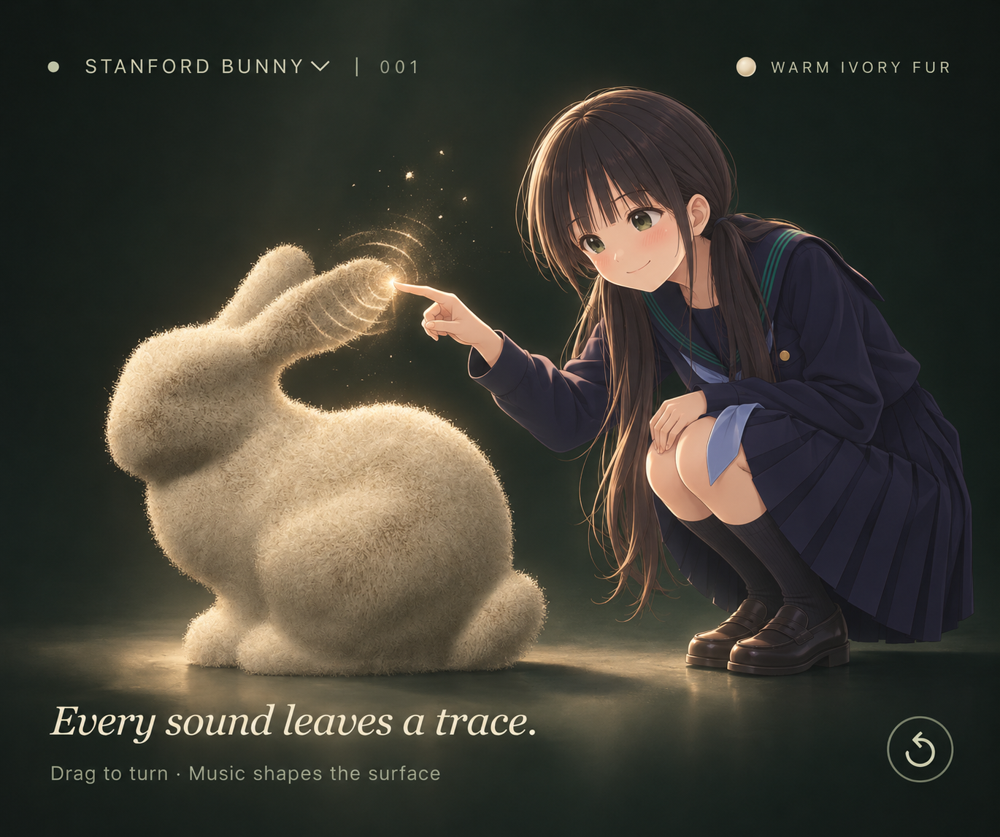
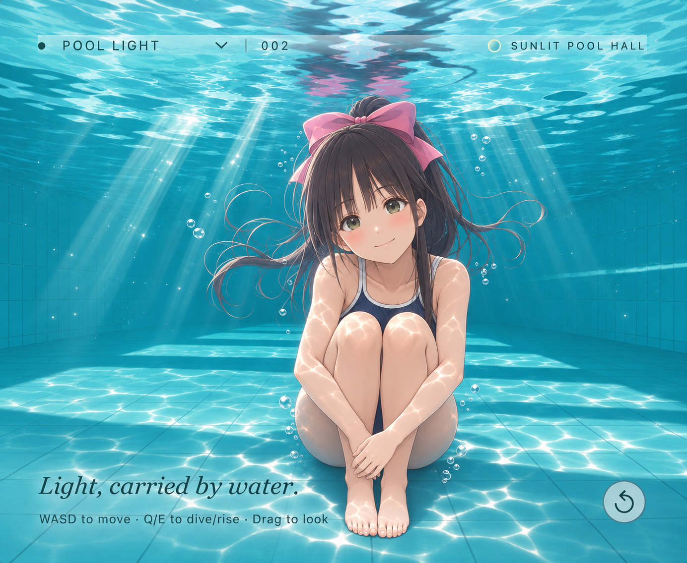
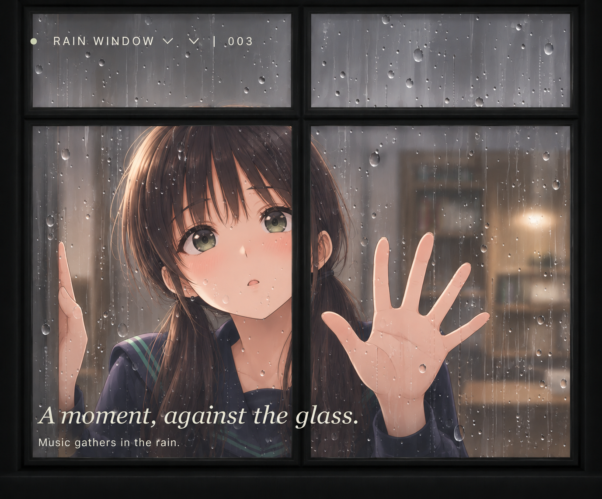
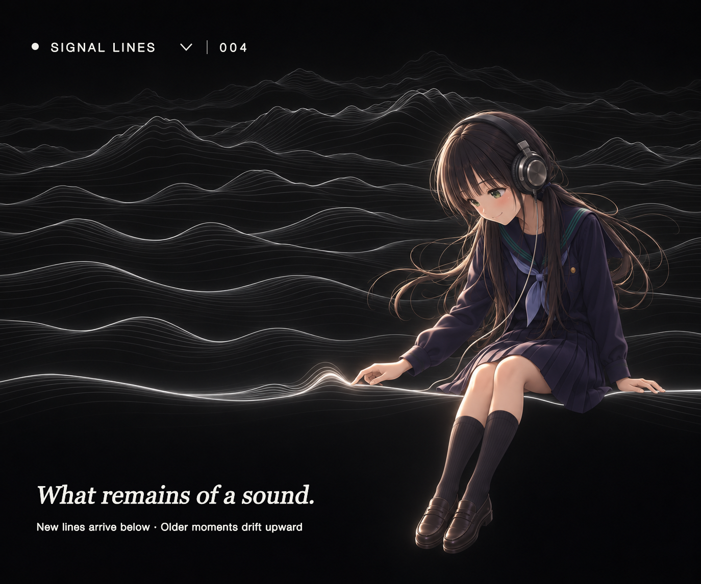
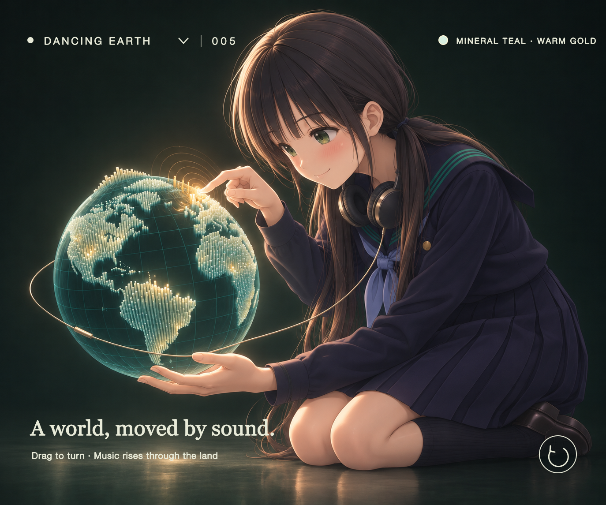

# SoundCanvas — The listening studio

[English](README.md) · [简体中文](README.zh-CN.md) · [日本語](README.ja.md)

A browser studio with five scenes that turn a track into sculpture, water, rain, stacked contours or a luminous world. Bring local audio, adjust its response, revisit a moment, and export a short film. No accounts, production dependencies, audio uploads, or build step.

## Stanford Bunny



A music-responsive Stanford Bunny with warm ivory fur or a copper surface. Audio shapes the form and the coat’s motion; the three controls tune its response.

*Concept illustration: the character and touch interaction are not implemented in the studio.*

## Pool Core — Pool Light



A sunlit white-tile pool hall with reflections, refraction, underwater caustics and a floating rubber duck. Walk along the pool, dive below the surface, or switch the duck off for an uninterrupted view of the water. This poolcore-inspired scene is named **Pool Light** in the studio.

*Concept illustration expressing the scene’s atmosphere; the character and illustrated lighting are not a screenshot of the real-time renderer.*

## Rain Window



*Concept illustration expressing the scene’s atmosphere; the character is not part of the real-time renderer.*

A close view of a dark, four-pane window with refracting droplets, merging drops and lingering wet trails. Switch between a procedural rainy garden, evening street and night lights without resetting the rain. Musical onsets encourage new drops; sustained and high-frequency energy influence rain arrivals. An independent lightning toggle enables sparse accent-driven flashes outside the window.

The scenery is an initial procedural illustration, not photography. The rain uses a bounded, fixed-step droplet simulation and a WebGL refraction pass, with state reconstruction for seeking and film export. It approximates water on glass rather than solving a full fluid model.

## Signal Lines



Black-and-white stacked contours inspired by Joy Division’s *Unknown Pleasures* cover. Every 0.18 seconds, a completed slice of the decoded audio enters below the older lines, pushing the history upward. At most 64 lines remain visible. The contours use local RMS audio profiles, a central envelope and foreground occlusion; they are not the cover’s original data or a frequency spectrum.

Impact adjusts height, Resonance smooths each contour, and Growth widens the central activity. Pausing freezes the scroll; seeking and film export reconstruct the same audio history. This scene shares the canvas dimensions of the other scenes.

*Concept illustration: the character and touch interaction are not implemented in the studio.*

### Stable thin-line rendering

WebGL's native one-pixel `LINE_STRIP` changed apparent brightness as the scrolling contours crossed the pixel grid, producing periodic light and dark bands. Signal Lines therefore builds every contour as a narrow triangle ribbon. Each ribbon vertex stores its signed distance from the centre line; the fragment shader converts that distance into fractional edge coverage and blends the edge pixels smoothly. The ribbon width is expressed in physical pixels and adjusted for the canvas pixel density, so ordinary and high-density displays retain a similar visual weight. A black fill beneath each new contour still hides the portions of older contours it crosses.

## Dancing Earth



A near-black mineral-teal globe whose continents are filled with rows of slender luminous columns. Low frequencies make the whole globe breathe, mid frequencies move neighboring land regions together, high frequencies warm the tips, and strong onsets send a restrained light wave across the land.

Impact changes column height, Resonance widens the moving groups and their release, and Growth reveals a denser resting field. Drag or use arrow keys to rotate the globe. Seeking and film export reconstruct the same state from audio time and settings. The filled land samples are prepared offline from the public-domain Natural Earth 1:110m land dataset; see the [data notice and regeneration details](assets/EARTH-NOTICE.md). This is an artistic audio mapping, not scientific, elevation or political data.

*Concept illustration: the character, headphones and touch interaction are not implemented in the studio.*

## Run locally

```sh
npm start
```

Open [the studio](http://127.0.0.1:8080). Python 3 is required for the static server. Alternatively, serve this folder with any HTTP static server; ES modules and the analysis worker require HTTP rather than opening the HTML as a file.

```sh
npm test
```

Tests use Node.js 20+ and its built-in runner. No dependency installation is necessary.

## Make something

1. Press play to load the original demo, or choose/drop your own audio file. Audio stays on your device. Limits: 80 MB and 10 minutes; codecs depend on your browser.
2. Choose any scene from the selector at the top left of the canvas, then adjust **Impact**, **Resonance**, and **Growth**. In Pool Light, click the scene, hold **W/A/S/D** to move and use **Q/E** to dive/rise. On the bunny and Dancing Earth, dragging or arrow keys rotate the view. On Earth, the controls change column height, regional grouping and field density. Space toggles playback when the page or canvas is focused.
3. Pool Light offers an independent **Duck on / Duck off** switch. The duck follows the water height and tilt; switch it off for pure water. Musical ball drops are currently disabled.
4. Use the waveform to revisit a moment. The same decoded track, time, settings and camera reproduce the same geometric state.
5. **Save settings** downloads a versioned JSON file. Controls, scene, pool position and both camera views also persist locally when browser storage is available. Settings do not include the audio or playhead; reopen the same audio and revisit the same timestamp to recreate a frame.
6. **Export film** captures 15 or 30 seconds from the playhead, shortened at the track end. Output is 1280×720, targets 30 fps, and includes audio. Your previous playback position and play/pause state are restored after export or cancellation.

Film export records in real time: keep the tab visible. Hiding the tab stops the recording with an explanation. Chrome/Edge usually export WebM (VP9/VP8 + Opus); other browsers may offer MP4. Output type and codecs are detected at runtime. Encoding and dropped frames depend on the browser and device; this is not an offline, frame-perfect renderer. Save settings and film downloads are local files.

Before audio loads, Pool Light and Dancing Earth run quiet ambient previews; the bunny starts at time zero. Audio modulation begins after a track loads. Silent tracks retain only baseline movement.

## How it works

- `src/scenes.js` selects the same renderer for preview and exported film. `src/water-engine.js` adapts Evan Wallace’s MIT WebGL Water heightfield (128×416) and projected caustic texture. `src/pool-hall-renderer.js` and `src/pool-hall-shaders.js` render a sunlit white-tile hall, windows, skylights, columns and inset pool, with reflected/refracted rays sampling the same architecture. The former cutaway pool and static demo sphere are no longer drawn. `src/water-timeline.js` adds seeded, bounded music impulses at fixed simulation steps. Pool assets load locally before recording begins. See [source and texture credits](assets/WATER-NOTICE.md).
- `src/water-surface.js` defines the 7.4×24 pool footprint, height scale, near-square physical simulation cells and sub-millimetre directional detail waves. Simulation disturbances use world distance, and reflection/refraction normals derive from the same height scale; there are no separate artistic slope multipliers. `src/water-caustics.js` adapts Evan’s differential-area focusing to the same physical floor coordinates and shared fine-wave derivatives.
- Water is stateful: fixed 60 Hz frames run two original simulation steps each, independently of display refresh rate. Up to 16 five-second GPU checkpoints help backward seeking; uncached timestamps replay from the seeded start, so a large seek or a control change late in a long track may take a moment. Replay proceeds in short batches with a “Settling the water…” hint; export prepares the selected timestamp before recording, and preparation can be cancelled. Before audio is loaded, the pool runs an ambient preview. Pausing loaded audio freezes its water state. This remains a heightfield demo, not a general fluid solver.
- `src/analysis.js` computes fixed 20 ms windows of loudness, crossover-band energy, onset envelope and slower memory. `src/analysis-worker.js` keeps this work off the UI thread. Stereo is downmixed for analysis with a channel fallback for near-phase-cancellation; playback retains the original channels.
- `src/model.js` maps current and historical features into subtle surface deformations of the Stanford Bunny scan. Shape depends on audio time, rather than accumulated display frames. Impact changes low-end/transient deformation; Resonance blends immediate energy with a slower response; Growth extends the history window and its geometric influence.
- `src/renderer.js` provides a WebGL mesh, normals, copper/ivory-fur lighting and orbit camera. Preview updates at up to 30 fps, with capped pixel density. There is no claim of universal performance or cross-browser pixel-identical decoding/rendering.
- `src/fur.js` and `src/fur-shaders.js` provide an optional 24-shell, alpha-tested coat, with static rest-space strand roots and audio-time sway. The toggle is saved with the settings. This is an artistic shell approximation, not strand-by-strand physical hair simulation.
- `scripts/prepare-earth.mjs` verifies and samples a pinned Natural Earth land file into compact local rows. `src/earth-motion.js` maps low, mid, high and onset features into bounded, seek-stable motion. `src/earth-renderer.js` draws the opaque ocean sphere, procedural grid and filled column field with depth occlusion. See the [Earth data notice](assets/EARTH-NOTICE.md).
- The procedural duck in `src/pool-hall-shaders.js` samples water height around its body to follow the surface and tilt with waves. Its visibility is saved with settings. This is a visual buoyancy approximation, not a rigid-body fluid simulation. Earlier ball-drop experiments in `src/pool-drop.js` remain in the source, but their controls, waveform markers, rendering and water displacement are disabled in this milestone.
- `src/audio.js` owns decoding, transport, source cleanup and worker analysis.
- `src/export.js` records a separate canvas and audio destination and restores the transport. `src/webm.js` supplies Duration metadata for unindexed streaming WebM without touching encoded clusters.

These are artistic audio-to-visual mappings, not beat tracking, source separation, semantic song understanding or a unique song fingerprint.

The studio currently offers five scenes: **Stanford Bunny**, **Pool Light**, **Rain Window**, **Signal Lines** and **Dancing Earth**. Mesh provenance and regeneration instructions are in [the model notice](assets/BUNNY-NOTICE.md).

Audio playback and film audio remain unprocessed. The underwater pool viewpoint is implemented; underwater audio treatment remains future work.

## Original six

[Open the original p5.js experience](classic.html). Keys 1–6 switch effects; Space opens the menu. The original scripts and bundled libraries remain available. [Original course-project notes and design sketches](docs/classic-project.md).

This version is a prototype on the development branch, not a published update to the deployed demo.
