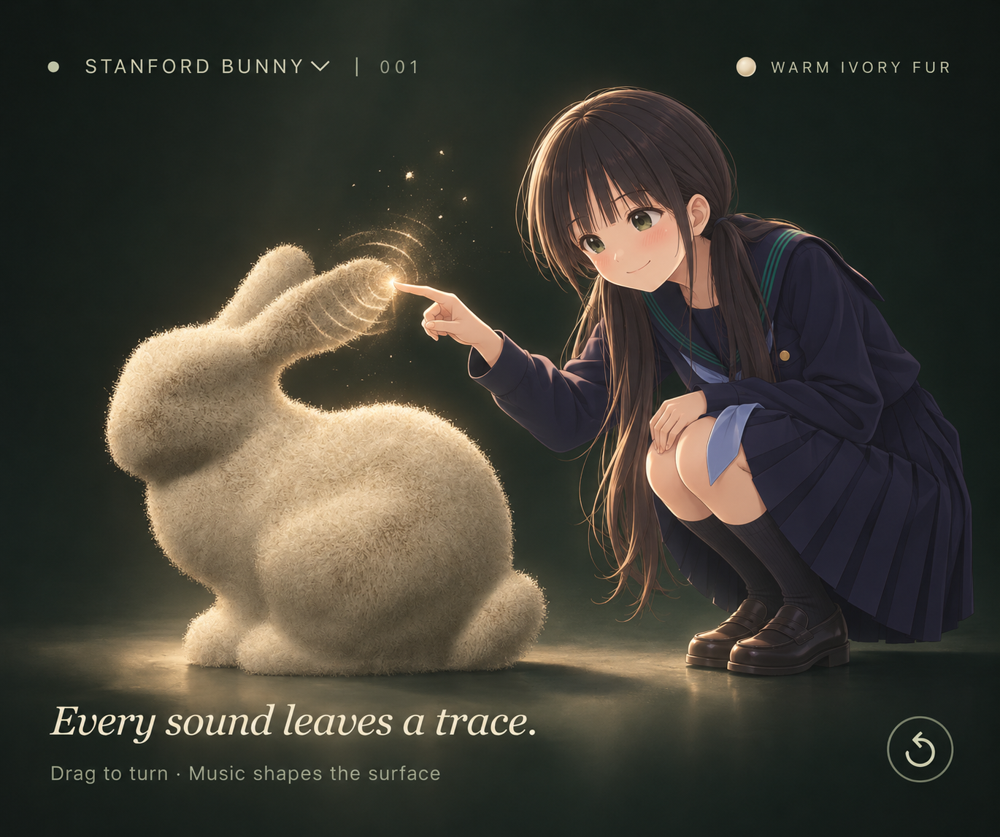
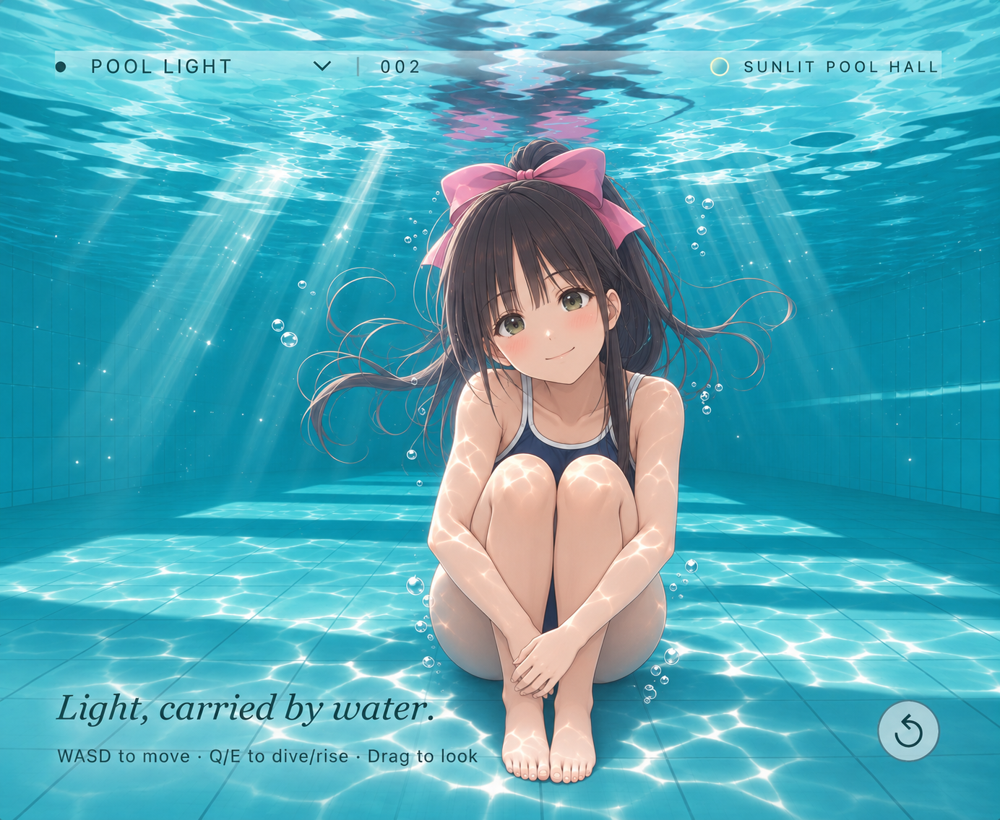
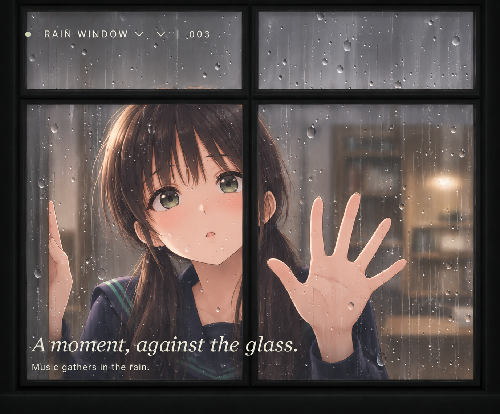
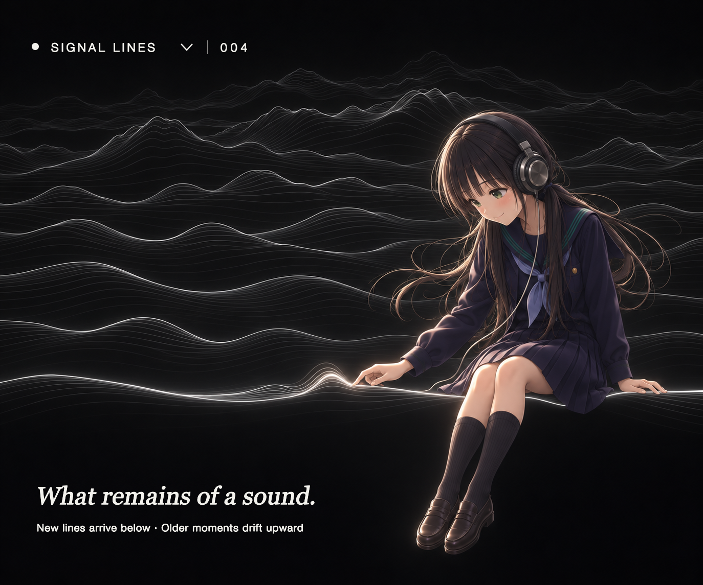
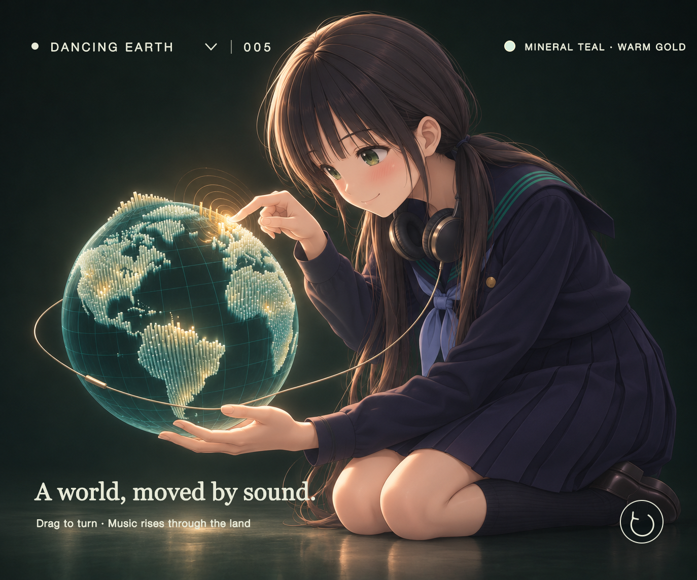

# SoundCanvas — 聆听工作室

[English](README.md) · [简体中文](README.zh-CN.md) · [日本語](README.ja.md)

五个场景把一首音乐变成雕塑、水面、雨窗、层叠轮廓或发光的世界。在浏览器中导入本地音频、调整视觉响应、回到某个时刻，再导出一段短片。无需账户、生产依赖安装、音频上传或构建步骤。

## Stanford Bunny



随着音乐变化的 Stanford Bunny，可切换暖象牙白毛发与铜质表面。声音影响形体和毛发的摆动，三个控制项用于调整响应。

*概念插画：画中的人物和触摸互动尚未在工作室中实现。*

## Pool Core — Pool Light



阳光、白色瓷砖与大片水池，包含反射、折射、水下焦散和漂浮的橡胶鸭。沿池边行走、潜入水下，或关闭鸭子，单纯凝视水面。这个受「池核」氛围启发的场景在工作室中名为 **Pool Light**。

*表达场景氛围的概念插画；其中的人物和光照表现并非实时渲染器的截图。*

## Rain Window



*表达场景氛围的概念插画；画中人物并非实时渲染场景的一部分。*

近距离凝视深色四格窗户，水珠折射窗外景色，合并滑落后留下水痕。可切换程序化生成的阴雨庭院、黄昏街道与夜间灯光，切换时保留雨滴状态。音乐起音增加新水滴，持续能量与高频活跃程度影响雨滴出现的密度；独立闪光开关让少数重音触发窗外亮光。

窗外目前是程序绘制的初版示意景色，并非摄影。雨滴采用数量受限、固定时间步的模拟与 WebGL 折射渲染，跳转和短片导出会重建对应状态。这是玻璃表面流水的近似表达，并非完整流体模拟。

## Signal Lines



受 Joy Division《Unknown Pleasures》封面启发的黑底白色层叠线条。每隔 0.18 秒，将一段已播放音频的轮廓加入底部，旧线平滑上移，最多显示 64 条。轮廓来自局部 RMS 音频采样，结合中央包络和前景遮挡；不是封面的原始数据，也不是频谱图。

Impact 调整峰高，Resonance 平滑线条细节，Growth 扩大中央起伏范围。暂停会冻结滚动，跳转和短片导出会重建同一段声音历史。画布尺寸与其他场景一致。

*概念插画：画中的人物和触摸互动尚未在工作室中实现。*

### 稳定的细线渲染

WebGL 原生的单像素 `LINE_STRIP` 在滚动时会不断穿过像素网格，线条覆盖的像素比例随位置改变，因而形成周期性的明暗条纹。Signal Lines 改为把每条轮廓构造成一条狭窄的三角形带。顶点记录自己到线条中心的带符号距离，片段着色器再把距离换算成边缘像素的覆盖率，以半透明过渡平滑线条边缘。线宽以物理像素表示，并根据画布的像素密度调整，使普通屏幕与高分屏保持接近的视觉粗细。每条新线下方仍绘制黑色填充，用来遮挡与它交叠的旧轮廓。

## Dancing Earth



接近黑色的矿物青地球，陆地区域由成排细长的发光柱填满。低频让整颗球体轻微呼吸，中频带动相邻陆地区域共同起伏，高频把柱尖染成暖金色，明显的起音则让一道克制的光波经过大陆。

Impact 控制柱群高度，Resonance 扩大共同运动的范围和回落时间，Growth 增加静止柱场的密度。拖动或使用方向键旋转地球；跳转与短片导出会根据音频时间和设置重建相同状态。陆地采样在构建时取自公共领域的 Natural Earth 1:110m 数据，详见[数据来源与再生成说明](assets/EARTH-NOTICE.md)。这是艺术化的音画映射，并非科学、海拔或政治数据。

*概念插画：画中的人物、耳机和触摸互动尚未在工作室中实现。*

## 本地运行

```sh
npm start
```

打开[工作室](http://127.0.0.1:8080)。静态服务器需要 Python 3，也可以使用其他 HTTP 静态服务器托管此目录。ES 模块和音频分析 Worker 需要 HTTP 环境，不能直接以本地文件方式打开 HTML。

```sh
npm test
```

测试使用 Node.js 20+ 的内置测试运行器，无需安装依赖。

## 开始创作

1. 点击播放以加载原有示例音乐，或选择、拖入自己的音频。音频始终留在设备上。限制为 80 MB、10 分钟；支持的编码格式取决于浏览器。
2. 在画布左上角选择任一场景，再调整 **Impact**（冲击）、**Resonance**（共鸣）与 **Growth**（生长）。在水池中使用 **W/A/S/D** 移动、**Q/E** 下潜或上浮；在兔子和 Dancing Earth 中，拖动或方向键用于旋转视角。地球场景的三个参数分别控制柱群高度、区域联动与柱场密度。页面或画布获得焦点时，空格切换播放与暂停。
3. 水池有独立的 **Duck on / Duck off** 开关。鸭子跟随水面高度与倾斜变化，关闭后只显示水景。随音乐扔球的功能当前停用。
4. 通过波形回到某个时刻。相同的已解码音轨、时间、设置和视角会重现相同的几何状态。
5. **Save settings** 下载带版本号的 JSON 设置文件。浏览器允许存储时，控制参数、场景、池内位置和两个场景的视角也会保存在本地。设置不包含音频或播放位置；重现某一帧需要重新打开相同音频并跳转到相同时间。
6. **Export film** 从当前播放位置导出 15 或 30 秒短片，接近音轨结尾时自动缩短。输出为 1280×720，目标为 30 fps，并包含音频。导出完成或取消后会恢复原来的播放位置及播放、暂停状态。

短片以实时方式录制，请保持标签页可见；隐藏标签页会停止录制并显示说明。Chrome/Edge 通常输出 WebM（VP9/VP8 + Opus），其他浏览器可能提供 MP4。容器和编码格式在运行时检测。编码和掉帧情况取决于浏览器与设备，因此不是离线逐帧精确渲染。设置和短片均下载为本地文件。

加载音频前，水池和 Dancing Earth 播放安静的环境预览，兔子停留在时间零。加载音轨后才开始由音频调制，静音音轨只保留基础运动。

## 实现方式

- `src/scenes.js` 为预览和导出选择相同的渲染器。`src/water-engine.js` 改编自 Evan Wallace 以 MIT 许可发布的 WebGL Water，使用 128×416 高度场及投影焦散纹理。`src/pool-hall-renderer.js` 和 `src/pool-hall-shaders.js` 渲染白瓷砖大厅、窗户、天窗、立柱和内嵌水池；反射与折射光线采样同一套建筑几何。原来的剖面水池和静态示例球不再绘制。`src/water-timeline.js` 在固定模拟步长下加入有种子且幅度受限的音乐扰动。录制开始前会完成本地水池资源加载。参见[代码与纹理来源](assets/WATER-NOTICE.md)。
- `src/water-surface.js` 定义 7.4×24 的水池范围、高度尺度、接近正方形的物理模拟网格及亚毫米级方向细波。扰动使用世界空间距离，反射与折射法线来自同一高度尺度，没有独立的艺术化坡度倍率。`src/water-caustics.js` 将 Evan 的微分面积聚光方法适配到相同的池底坐标与细波导数。
- 水模拟有历史状态：以固定 60 Hz 帧运行，每帧执行两次原始模拟步进，不依赖显示刷新率。最多保存 16 个间隔五秒的 GPU 检查点来加速向后跳转；未缓存的时刻需要从带种子的初始状态重放，所以长距离跳转或在长音轨后段调整控制项可能需要等待。重放分批执行并显示“Settling the water…”；导出前会先准备目标时刻，可以取消准备。暂停已加载的音频会冻结水面状态。这仍是高度场演示，并非通用流体求解器。
- `src/analysis.js` 以固定 20 ms 窗口计算响度、分频能量、起音包络与慢速记忆，`src/analysis-worker.js` 将分析移出 UI 线程。立体声会合成为单声道用于分析；接近相位抵消时回退到单个声道。播放仍保留原始声道。
- `src/model.js` 将当前与历史音频特征映射为 Stanford Bunny 扫描模型的细微表面变形。形状依赖音频时间，而不是累计显示帧。Impact 控制低频与瞬态变形，Resonance 混合即时能量与较慢响应，Growth 延长历史窗口并扩大其几何影响。
- `src/renderer.js` 提供 WebGL 网格、法线、铜和象牙白毛发的光照，以及环绕相机。预览最高更新至 30 fps，并限制像素密度；不保证所有设备的性能或不同浏览器间逐像素一致的解码与渲染结果。
- `src/fur.js` 和 `src/fur-shaders.js` 提供可选的 24 层壳式毛发，使用透明度测试、静态原始空间毛根及随音频时间变化的摆动。材质开关会随设置保存。这是艺术化的壳层近似，并非逐根毛发的物理模拟。
- `scripts/prepare-earth.mjs` 校验固定版本的 Natural Earth 陆地文件，并将其采样为紧凑的本地条纹数据。`src/earth-motion.js` 把低频、中频、高频与起音映射为有界且可通过跳转重现的运动；`src/earth-renderer.js` 以深度遮挡绘制不透明海洋球体、程序化经纬网与填充大陆的柱场。参见[地球数据说明](assets/EARTH-NOTICE.md)。
- `src/pool-hall-shaders.js` 中的程序化鸭子采样身体周围的水面高度，跟随水面升降和倾斜。显示开关随设置保存。这是视觉浮力近似，不是刚体与流体耦合模拟。早期扔球实验代码仍保留在 `src/pool-drop.js`，但本阶段关闭了相关控制、波形标记、球体渲染与排水扰动。
- `src/audio.js` 负责解码、播放控制、音源清理和 Worker 分析。
- `src/export.js` 录制独立画布与音频输出，并恢复原播放状态。`src/webm.js` 为无索引的流式 WebM 补充 Duration 元数据，不改动已编码的数据簇。

这些是艺术化的音画映射，不是节拍追踪、音源分离、歌曲语义理解或唯一的歌曲指纹。

目前提供 **Stanford Bunny**、**Pool Light**、**Rain Window**、**Signal Lines** 和 **Dancing Earth** 五个场景。网格来源及重新生成方法见[模型说明](assets/BUNNY-NOTICE.md)。

播放与导出的音频尚未添加音效。水下视角已经实现，水下听觉效果留待后续开发。

## 最初的六种效果

[打开原版 p5.js 体验](classic.html)。数字键 1–6 切换效果，空格打开菜单。原始脚本与随附库仍保留。参见[原课程项目说明与设计草图](docs/classic-project.md)。

此版本是开发分支上的原型，尚未更新到已部署的演示站点。
